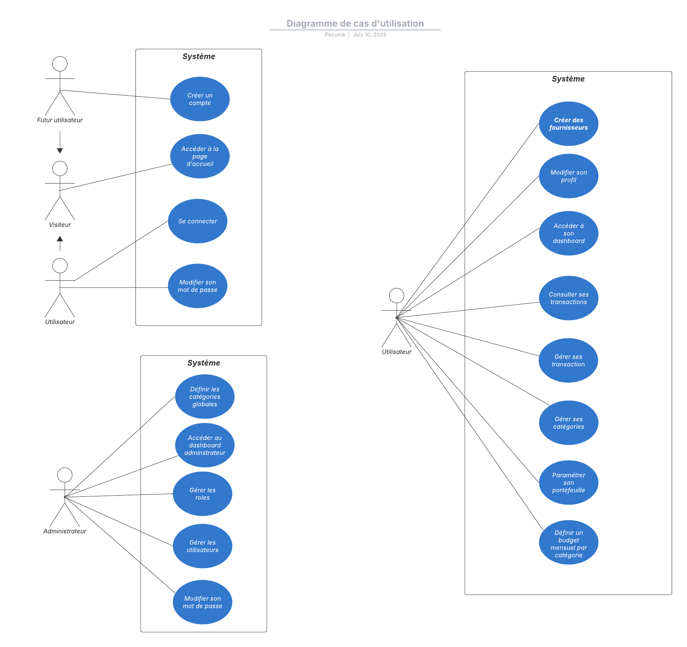

## Diagramme de cas d'utilisation

Le diagramme de cas d'utilisation permet de représenter les interactions entre les acteurs externes (les utilisateurs) et le système (Pecunia).
On y décrit les fonctionnalités du système auxquelles l'utilisateur peut avoir accès.
Ce diagramme permet de mieux identifier les caractèristiques et les besoins du système, avec les scénarios d'utilisation.

