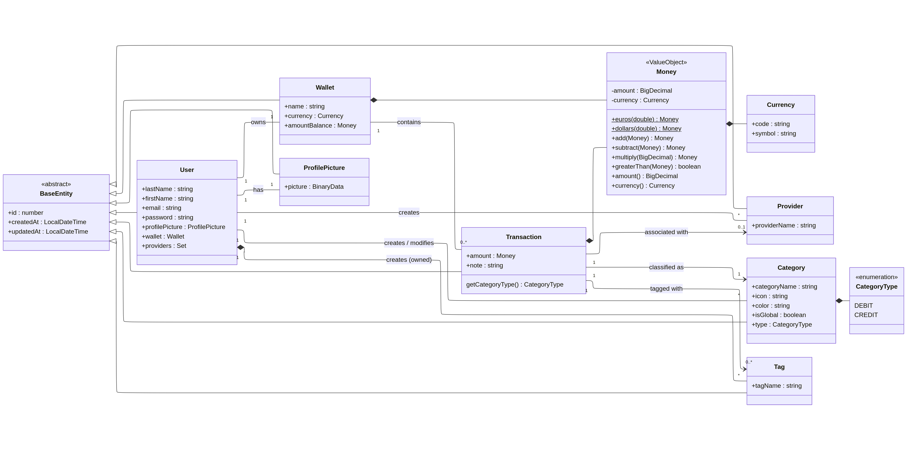

## Diagramme de classes

Un diagramme de classes représente la structure interne du système en modélisant les classes, les attributs, méthodes et relations.
A l'aide des différents schémas de base de données de la méthode MERISE, nous avons pu établir le diagramme de classes suivant en y ajout les classes comme MONEY (value object gérant les devises), BASENTITY (héritage pour gérer les horodatages) et l'énumération avec CATEGORYTYPE qui distingue les débits et les crédits.

