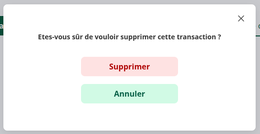

# NG-ZORRO

**NG-ZORRO** est une bibliothèque de composants Angular basée sur **Ant Design**, offrant une large gamme de composants prêts à l'emploi, stylisés et accessibles.

---

## **Intégration dans le projet**

### **Contexte d'utilisation**
NG-ZORRO est principalement utilisé pour :
- Les modales (`nz-modal`).
- Les formulaires et autres composants UI.

---

### **Exemple d'intégration : Composant Modal**

#### **Code HTML/Template**
```html
<div>
    <ng-content>
        <app-ui-button
            nz-button
            (click)="showModal()"
            select="[modal-trigger]"
            size="large"
        >
        </app-ui-button>
    </ng-content>
    <nz-modal
        [(nzVisible)]="isVisible"
        [nzTitle]=""
        [nzFooter]="null"
        (nzOnOk)="handleOk()"
        (nzOnCancel)="handleCancel()"
        [nzClassName]="'modal'"
    >
        <ng-container *nzModalContent>
            <p>{{ content }}</p>
            <app-ui-button
                nz-button
                [nzType]="confirmType"
                (click)="handleOk()"
                variant="alert"
                [minWidth]="200"
                [maxWidth]="392"
            >
                {{ confirmText }}
            </app-ui-button>
            <app-ui-button
                nz-button
                nzType="default"
                (click)="handleCancel()"
                variant="success"
                [minWidth]="200"
                [maxWidth]="392"
            >
                {{ cancelText }}
            </app-ui-button>
        </ng-container>
    </nz-modal>
</div>
```

---
## **Modal de suppression de transaction**

### **Contexte**
La modal de suppression de transaction est utilisée pour confirmer une action irréversible, comme la suppression d'une transaction financière. Elle garantit que l'utilisateur est conscient des conséquences de son action.

---

### **Fonctionnalités**
- **Affichage conditionnel** : La modal s'affiche uniquement après un clic sur le bouton déclencheur.
- **Personnalisation** :
  - Texte du contenu (`content`).
  - Texte des boutons de confirmation et d'annulation (`confirmText`, `cancelText`).
  - Type de bouton de confirmation (`confirmType`).
- **Gestion des événements** :
  - Émission d'un événement `confirmAction` lors de la confirmation.
  - Émission d'un événement `cancelAction` lors de l'annulation.

---

### **Exemple visuel**


---

### **Utilisation dans le code**
Pour utiliser cette modal, importez le composant `ModalComponent` dans votre module ou composant parent, puis utilisez-le comme suit :

```html
<app-ui-modal
    [content]="'Êtes-vous sûr de vouloir supprimer cette transaction ?'"
    [confirmText]="'Supprimer'"
    [cancelText]="'Annuler'"
    (confirmAction)="onConfirmDelete()"
    (cancelAction)="onCancelDelete()"
>
    <app-ui-button nz-button size="large">
        Supprimer la transaction
    </app-ui-button>
</app-ui-modal>

